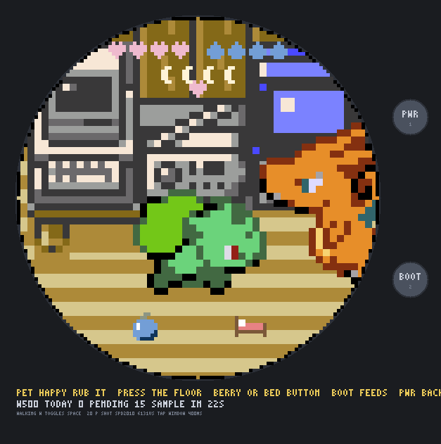
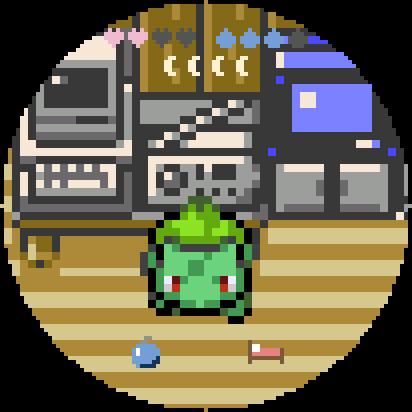
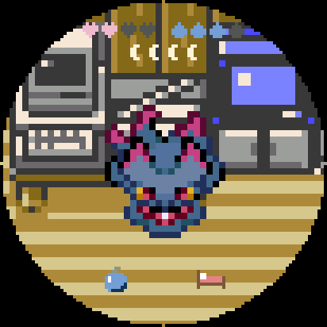

<section class="prose" markdown="1">

## A pet, not a pedometer

The Pokewalker already counts steps and turns them into Watts. Pet mode gives that walking
somewhere to go. You pick a Pokémon from your team and it moves into a room: it gets hungry,
sleepy and bored, it shows a ! on the walking screen when it wants you, and it cheers up when
you rub it, feed it a berry or play with it. Leave it alone and it gets sad, nothing worse,
and one Oran Berry and a rub put it right.

The room is the real bedroom from Pokémon Gold, pulled off the cartridge: the PC, the radio,
the TV, the bookshelf, the stairs and the floor the game itself says you can walk on. The
camera follows the pet, so the room scrolls round it as it goes.

The pet is its HeartGold follower sprite, the little walking Pokémon that trails behind you
in that game. Every species from 1 to 251 has one, four directions with a step in each, and
the shiny colours sit right beside the normal ones. Ask for any Pokémon and it walks in as
itself.

## Friends drop in

The rest of the team visit. A happy pet gets a caller every few hours: another of your
Pokémon walks in from the side of the room, the pet makes space, and the two bounce at each
other face to face for a while before the visitor heads off again. Both get a heart for it.
Each visitor is its own follower sprite, so whoever is on your team is who turns up, and they
take turns.

</section>

<figure class="pixel" style="margin-inline:auto;">
  
  <figcaption>Charizard calls on Bulbasaur. Four hearts: a visit is good for both of them.</figcaption>
</figure>

<section class="prose" markdown="1">

## The radio

Tap the radio on the desk and the pet walks over, switches it on and dances: turning left,
front and right on the half beat, hopping on the beat, notes rising off the radio. The music
is the walker's own Radio, Gen 1's songs played on an emulated Game Boy sound chip, so it is
whatever you have starred, or Cycling, Surfing Pikachu and a few others if you have not.

When the music comes on, another member of the team drops in to dance too.

## The bug

That last part came later. The first version had visits on their own timer: a friend walked
in, the two bounced at each other for eight seconds, the friend walked out. And while a
friend was there, the pet was held facing it, because that is what playing together looks
like.

Then a friend arrived halfway through a song. The song ended, the pet went back to wandering,
and the visit was still holding it facing its friend. So it walked away from Charizard while
looking straight at him.

</section>

<figure class="pixel" style="margin-inline:auto;">
  
  <figcaption>The original. Near the end, Bulbasaur leaves Charizard without turning round.</figcaption>
</figure>

<section class="prose" markdown="1">

## Now it is the ending

It read as a moonwalk, and a moonwalk at the end of a dance is better than anything planned.
So it is planned now.

A friend who comes for the radio stays for the whole song. When the music stops the pet
moonwalks two cells away from it, at half pace, still facing it, legs going. Only once it has
finished does the friend walk off. With nobody visiting it moonwalks anyway, as an encore.

</section>

<figure class="pixel" style="margin-inline:auto;">
  
  <figcaption>Misdreavus and Caterpie. Song ends, Misdreavus peaces out, Caterpie goes home.</figcaption>
</figure>

<section class="prose" markdown="1">

## What comes next

- **Putting it on the board.** It builds for the device; it has not run there yet. The
  board's own real-time clock will let a pet catch up on the hours the walker was off.
- **Spending Watts.** A department store selling berries and the Gen 2 bedroom decorations:
  dolls, big dolls, carpets, plants, posters, consoles. Mom will buy some on her own when
  your savings pass a milestone, as she did in Gold.
- **Looking after it properly.** Poison and paralysis from neglect with their own cure
  berries, grooming, and Pokérus, which turns up about once in three hundred days and doubles
  friendship while it lasts.
- **Eggs and evolution.** Eggs that hatch by steps, the way they did in the games, and
  friendship evolutions on Gen 2's own conditions.

</section>
