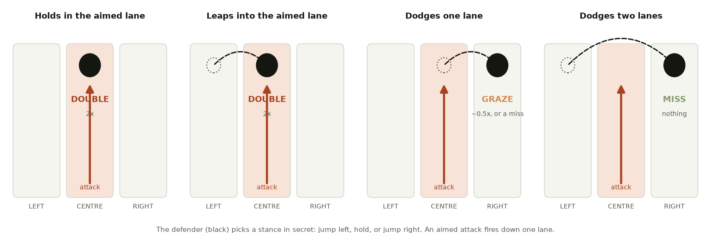
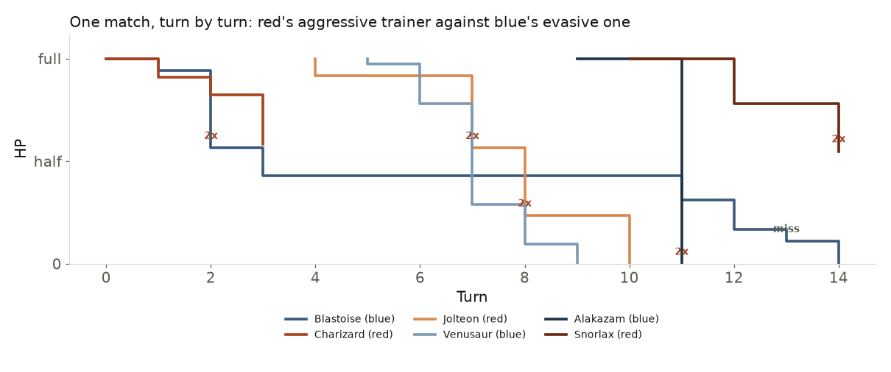
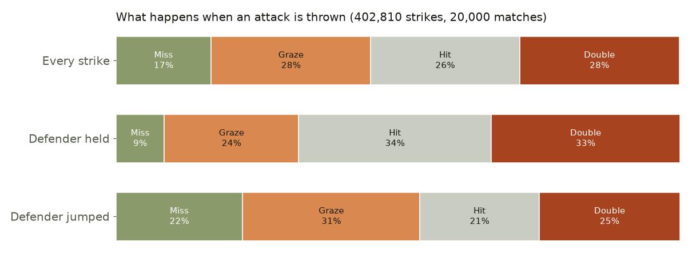
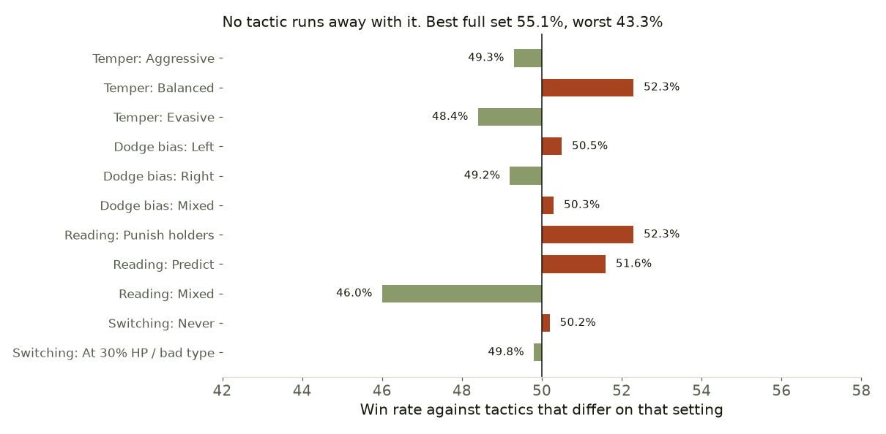

<section class="prose" markdown="1">

## Battles with a mind game in them

Underneath, these are Generation 1 battles: the same stats, damage formula, type chart,
critical hits, status conditions and switching as Red and Blue, for all 151 Pokémon and
165 moves.

On top sits a field with three lanes. Each turn, both sides choose a move and a stance at
the same time, and neither sees the other's choice until both are locked in. Then everyone
lands, and the attacks fly.

</section>

<figure style="margin-inline:auto;">
  
  <figcaption>An aimed attack down the centre lane, and four ways the defender can meet it.</figcaption>
</figure>

<section class="prose" markdown="1">

## What an attack does

Moves come in shapes:

- **Aimed** moves, like Thunderbolt, Flamethrower or Body Slam, go down one lane. A Pokémon in that lane
  takes double. One lane over, it is usually grazed for about half. Two lanes over, it is
  missed.
- **Wide** moves, like Surf, Earthquake and Razor Leaf, hit their lane and the lanes beside it, at three quarters of their power.
- **Centre bursts**, like Fire Blast and Pin Missile, hit their lane in full and always catch
  the lanes beside them with the edge.
- **Follow** moves, like Swift and Psychic, track the target and never miss, but never land
  for double either.

The Pokémon matter as much as the lanes. A fast one sometimes clears two lanes in a single
leap. A heavy one takes less from a graze. And a Pokémon that jumps attacks off balance, at
three quarters of its power. Without that cost, the evasive trainer won 58% of matches and
everyone would have played that way.

## A turn, as the engine writes it

This is turn 11 of a match between an aggressive trainer and an evasive one. Snorlax has
just come in for red. Alakazam is nearly untouched.

```
-- turn 11
SNORLAX jumps left -> centre
ALAKAZAM jumps left -> centre
SNORLAX uses DOUBLE-EDGE (Aimed) at the centre lane
  -> DOUBLE on ALAKAZAM: 130 damage, 0 HP left
  SNORLAX Recoil 32 (203 left)
  ALAKAZAM faints!
```

Alakazam read Snorlax as coming left and jumped to meet it, straight into the lane the
Double-Edge was aimed at. Full health to fainted in one strike, even with Snorlax swinging
off balance.

Two turns later the same trick failed. Blastoise, on 17 HP, jumped clear and Snorlax's
Double-Edge went through an empty lane:

```
-- turn 13
SNORLAX holds the right lane
BLASTOISE jumps centre -> left
SNORLAX uses DOUBLE-EDGE (Aimed) at the right lane
  -> MISS on BLASTOISE: 0 damage, 17 HP left [dodged clean]
```

</section>

<figure style="margin-inline:auto;">
  
  <figcaption>The whole match. Every drop marked 2x is someone standing in, or jumping into, the wrong lane.</figcaption>
</figure>

<section class="prose" markdown="1">

## Twenty thousand matches

A twist like this is easy to get wrong. If dodging is too strong, nobody ever stands still.
If it is too weak, nobody bothers to move. So the engine plays itself: three against three
at level 50, every combination of tactics against every other, with the teams swapped each
time so only the tactics decide.

Across 402,810 strikes, a little over a quarter land for double and about the same share
are grazes. A Pokémon that holds still is hit far more often. One that jumps is missed far
more often, and still takes double a quarter of the time, because the other trainer guessed
where it would land.

</section>

<figure style="margin-inline:auto;">
  
  <figcaption>Holding still gets you hit. Jumping gets you missed, unless they read you.</figcaption>
</figure>

<section class="prose" markdown="1">

## Football Manager, not Street Fighter

You don't press buttons every turn. You set tactics, the way a manager sets team
instructions:

- **Temper**: aggressive, balanced or evasive.
- **Dodge bias**: favour left, favour right, or mix it up.
- **Reading**: punish a Pokémon that keeps holding, or predict where it will jump.
- **Switching**: pull a Pokémon out at low HP or a bad type matchup.
- **Move priority**, per Pokémon.

The AI plays from those, using only what both trainers can see, including how each
Pokémon has jumped so far. In a live match you are on the touchline with a handful of
direct orders to spend. In an automated one, you watch the replay afterwards and change
your instructions.

The test that matters is whether any setting wins on its own. None does. The best complete
set of tactics wins 55.1% of its matches and the worst 43.3%. A match lasts about 16 turns.

</section>

<figure style="margin-inline:auto;">
  
  <figcaption>Every setting lands within a few points of even. Guessing at random (“mixed” reading) is the one that costs you.</figcaption>
</figure>

<section class="prose" markdown="1">

## The same battle everywhere

The engine is a small Rust library with no floating point and no dependencies. The same
code will run on the walker, in a browser and on the server that hosts online battles, and
a given seed plus both trainers' choices produce the same result on every one of them. Five
hundred simulated battles came out byte for byte identical on a PC and in WebAssembly.

That means a battle never has to be sent as video. A whole match is the random seed, the two
teams and each turn's choices: about a hundred bytes. The walker downloads that and replays
the fight itself.

## Still to come

Nine Generation 1 moves aren't in yet: Counter, Bide, Mimic, Metronome, Mirror Move,
Transform, Conversion, Disable and Substitute. Wrap and its kin do their damage but don't
trap yet. When a Pokémon faints, the next one in line comes in.

Next is the part you see: the two Pokémon facing each other on the walker's round screen,
jumping between lanes, with the real move animations aimed at wherever the target ends up.

</section>
