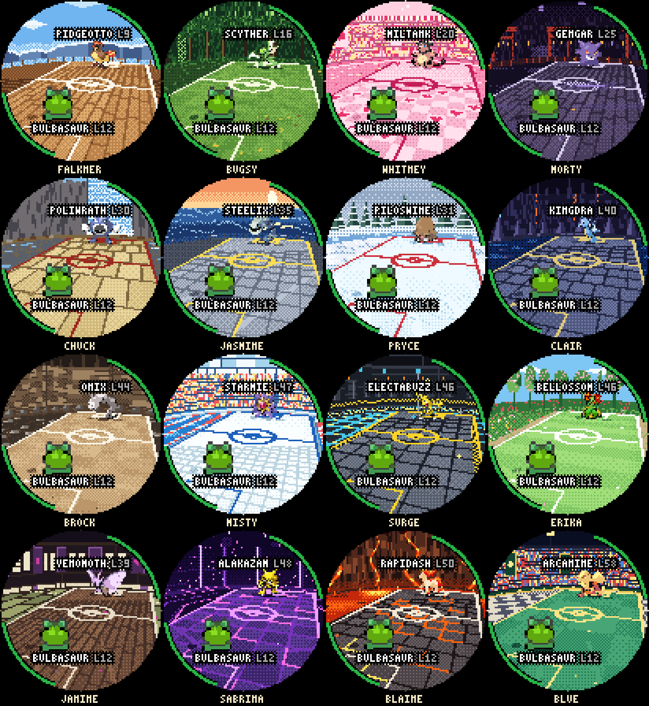
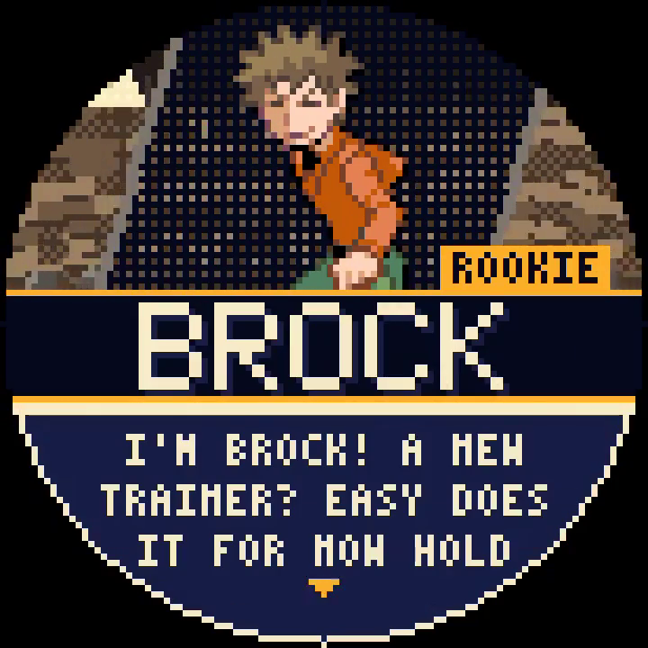
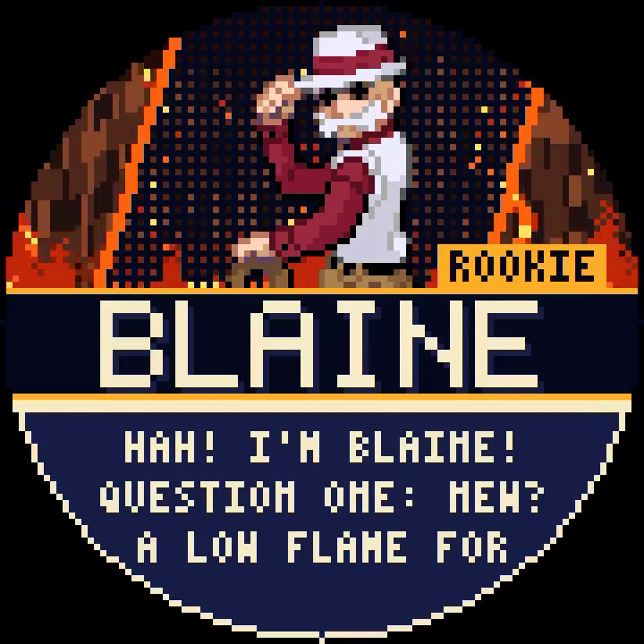
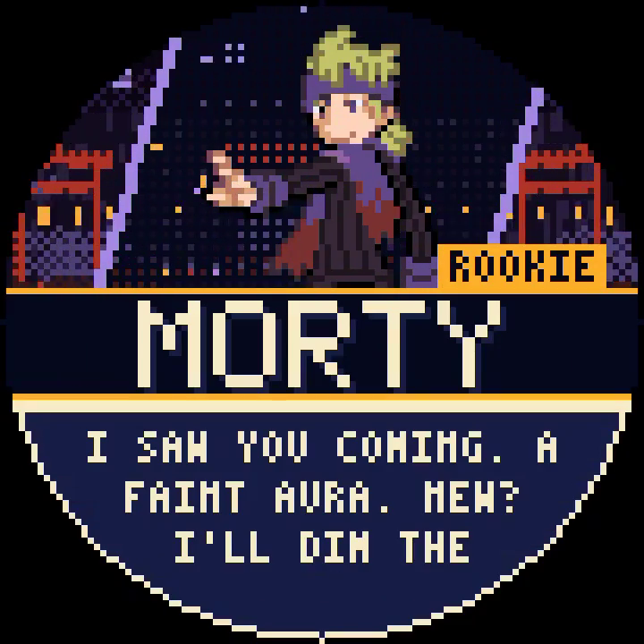
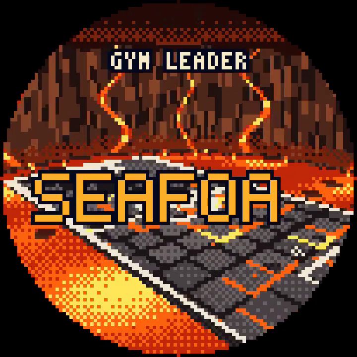
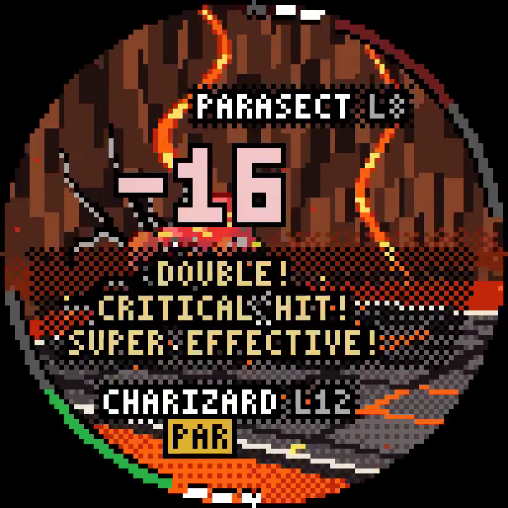
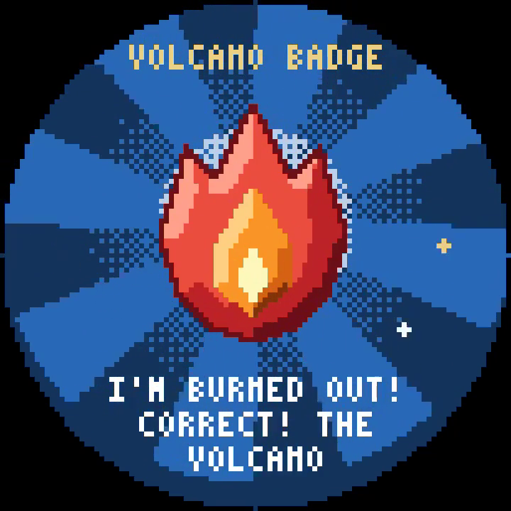
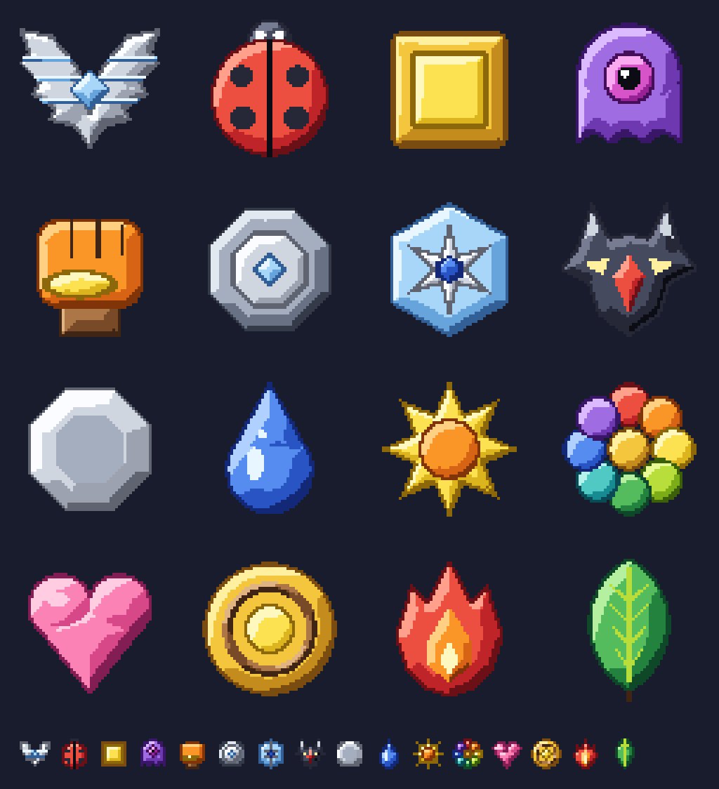

<section class="prose" markdown="1">

## Sixteen leaders, sixteen arenas

Every leader from Johto and Kanto, Falkner to Blue, fights in a stadium built in their own
style. The field, the lines and the three lanes are the same everywhere, so a battle plays
the same; what changes is everything around it.

</section>

<figure style="margin-inline:auto;">
  <video controls preload="metadata" poster="../assets/img/pokewalker/gym-tour-poster.png"
         width="480" height="480">
    <source src="../assets/video/pokewalker/gym-tour.mp4" type="video/mp4">
  </video>
  <figcaption>Every leader's entrance, Morty and Surge into battle, then Blaine's whole fight in the volcano and all sixteen badges.</figcaption>
</figure>

<figure class="pixel" style="margin-inline:auto;max-width:620px;">
  
  <figcaption>The sixteen arenas, from the battle camera.</figcaption>
</figure>

<section class="prose" markdown="1">

Falkner fights on a wooden deck high above the mountains, with birds overhead. Bugsy's
field is a forest floor under falling leaves. Morty's shrine is dark boards and red gates
with fog drifting across it. Jasmine's lighthouse turns its beam over the sea at dusk,
Pryce's floor is an ice rink in falling snow, and Surge's steel plate has circuits running
through it and a barrier that arcs. Misty fights over a pool, Erika in a garden of blossom,
Sabrina in a violet hall where the rings pulse. Blaine fights in a volcano: the floor is
cracked basalt with lava moving underneath, and embers drift up the crater wall.

## Getting there

You don't get to walk into a gym. Leaders come in order, and each one asks for something
before you can challenge them: steps walked since your last badge, a big enough team, and
a strong enough lead Pokémon.

| Leader | Steps since last badge | Team | Strongest |
| --- | --- | --- | --- |
| Falkner | 500 | 1 | level 5 |
| Morty | 2,000 | 2 | level 11 |
| Clair | 4,000 | 3 | level 19 |
| Brock | 5,000 | 3 | level 21 |
| Sabrina | 7,000 | 5 | level 31 |
| Blue | 10,000 | 6 | level 35 |

That's 72,000 steps from the first badge to the last. The battle menu tells you what's
still missing ("WALK 2,000 MORE", "NEED 3 POKEMON") and the walking screen announces it
when the next leader is ready for you.

Lose, and that leader rests until tomorrow. You can't grind a gym; you come back.

## The leader reads your team

When you arrive, the leader looks at what you've brought: how many Pokémon, how strong your
best one is, whether any of them can hit the gym's type hard, how many badges you already
hold and how you've been doing in battle. From that they decide what kind of trainer you
are: **rookie, trainer, ace, veteran or champion-class**.

Then they choose their team to suit. Every leader has a roster built from the Pokémon
they've used across the series, not just one game's party, and they pick from it: fewer,
weaker Pokémon for a newcomer, their best for a veteran. Their ace is always a little
stronger than yours, and they never bring fewer Pokémon than you do.

It's a challenge, not a wall. Across thousands of simulated battles at every tier, a
challenger wins about four times in ten, with good tactics doing the rest. Come back the
same day with the same team and you'll meet the same leader team, so a loss teaches you
something.

## What they say

The leader tells you what they've made of you before a ball is thrown. Every leader has
their own lines, written for this, and the middle of their speech depends on your tier.
Brock to a newcomer: *"I'm Brock! A new trainer? Easy does it for now."* Brock to someone
with a reputation: *"So you're the one. No holding back!"*

</section>

  <figure class="pixel" style="margin:0;"><figcaption>Brock has you down as a rookie.</figcaption></figure>
  <figure class="pixel" style="margin:0;"><figcaption>Blaine, in the volcano.</figcaption></figure>
  <figure class="pixel" style="margin:0;"><figcaption>Morty saw you coming.</figcaption></figure>

<section class="prose" markdown="1">

## The entrance

Each gym battle opens with the camera circling the arena while the gym's name types out.
Then the leader's portrait sweeps in over their element (Blaine through flame, Morty out of
fog, Surge in a crackle of lightning) with their name on a ribbon and your tier on a gold
tab beside it. Their speech types out underneath. BOOT or a tap skips ahead.

After that it's the battle you already know: the match card, the throws, the lanes, the
clashes on critical hits and knockouts into the wall. Only now the wall is a crater rim, or
a lighthouse rail, or a garden hedge.

</section>

  <figure class="pixel" style="margin:0;"><figcaption>The title card.</figcaption></figure>
  <figure class="pixel" style="margin:0;"><figcaption>A critical hit in the crater.</figcaption></figure>
  <figure class="pixel" style="margin:0;"><figcaption>The Volcano Badge.</figcaption></figure>

<section class="prose" markdown="1">

## The badges

Win, and the badge flips in on a burst of light, lands with a ring, catches the light, and
the leader says their piece. Each of the sixteen is drawn large for that moment, with metal
shading and a glint that comes round every couple of seconds, and small for your trainer
card, where the ones you haven't earned wait as grey shapes.

</section>

<figure class="pixel" style="margin-inline:auto;max-width:560px;">
  
  <figcaption>The sixteen badges, large and small. Original drawings.</figcaption>
</figure>

<section class="prose" markdown="1">

## How it's built, and how it grows

Gyms are data, so they can change without rewriting anything:

- **The ladder** is one table: steps, team size and level for each leader. Retuning it is
  editing a row.
- **Each leader** is a roster, a set of tiers, some lines and a stage. Adding a leader, or a
  rematch with a stronger roster, is a new entry rather than new code.
- **The balance** is measured, not guessed. A test plays thousands of battles at every tier
  and fails if the challenger's chances drift outside a band, so a change to the battle
  engine can't quietly make a gym unbeatable.
- **The arenas** all share one field and swap the world around it, which is why a new
  stage is cheap.

What comes next builds on those pieces: rematches once you hold all sixteen, an Elite Four
after them, and the portal taking part, so a badge you win shows on your trainer profile
and the leaderboards know who's been through which gym.

</section>
