<section class="prose" markdown="1">

## A whole match

This is a full three-on-three, start to finish: the match card, the send-outs, a beam
struggle on a critical hit, knockouts into the wall, a switch, and the winner's board. The
engine played every turn; nothing here is scripted.

</section>

<figure style="margin-inline:auto;">
  <video controls preload="metadata" poster="../assets/img/pokewalker/battle-match-poster.png"
         width="480" height="480">
    <source src="../assets/video/pokewalker/battle-match.mp4" type="video/mp4">
  </video>
  <figcaption>AARON against SILVER at Indigo Plateau. Bulbasaur, Charizard and Marill at level 12.</figcaption>
</figure>

<section class="prose" markdown="1">

## Starting one

On the walker, open the ball and swipe to the games ring. The crossed swords are BATTLE.
From there:

- **Quick battle** puts you against a rival whose team is matched to yours.
- **Gym challenge** puts you against the next leader you haven't beaten.
- **Online** is greyed out until the portal's live battles reach the walker.

BOOT starts the highlighted one and PWR backs out. PWR in the middle of a battle walks away
from it, and walking away records nothing.

</section>

  <figure class="pixel" style="margin:0;">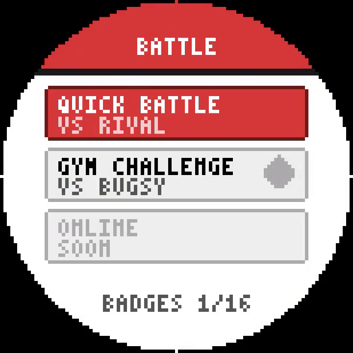<figcaption>The battle menu.</figcaption></figure>
  <figure class="pixel" style="margin:0;">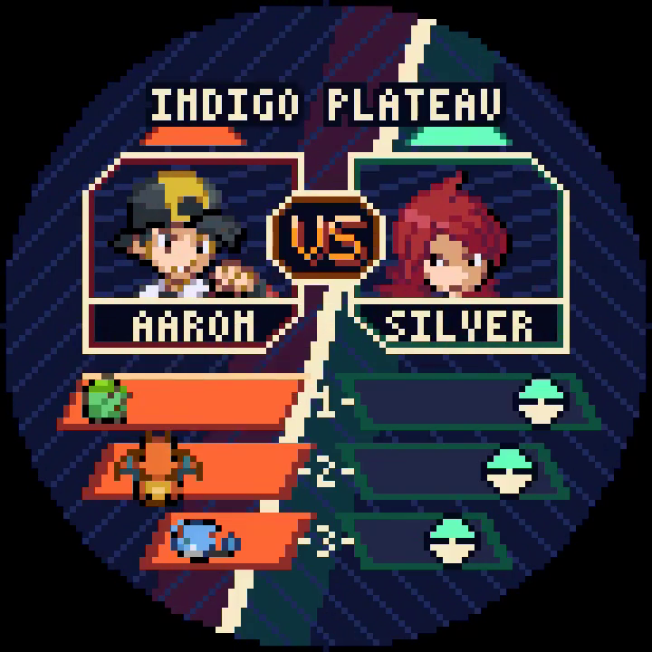<figcaption>The match card. One bar per Pokémon.</figcaption></figure>
  <figure class="pixel" style="margin:0;">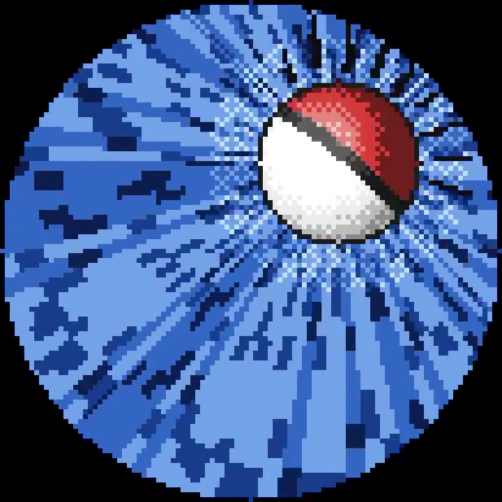<figcaption>Each Pokémon comes out of its own ball.</figcaption></figure>

<section class="prose" markdown="1">

## The match card and the send-out

A match opens on a card in the style of the anime's League scoreboard: both trainers'
portraits, the event, and a bar for every Pokémon on each side. It comes back between
knockouts with that Pokémon's bar gone dark, so you always know the score.

Then the balls come out. Each Pokémon is thrown in whatever ball it lives in on the walker,
spinning at the camera, before it lands on its mark, pops open with the cartridge's own
sound and the Pokémon forms out of the light. Switching one out is the classic red beam:
it hits, the Pokémon becomes a ball of red light, and the light goes home.

## How a turn works

The field is a clay stadium with three lanes: left, centre and right. Every turn, both
sides choose a move and, in secret, where to stand: jump left, hold, or jump right. Both
are revealed at once.

- Stand in the lane an attack is aimed at, or jump into it, and it lands for **double**.
- Jump one lane clear and it may still clip you for a **graze**, about half.
- Get two lanes clear and it **misses**.

Some moves cover more than one lane, and some always find their target. A fast Pokémon can
clear two lanes in one leap, a heavy one shrugs off grazes, and jumping costs a little
power. Under all of that sit Generation 1's real rules: stats, types, critical hits, status
and switching. A trainer's tactics decide how their Pokémon play it: how aggressive, which
way they like to dodge, whether they punish a Pokémon that keeps standing still.

</section>

  <figure class="pixel" style="margin:0;">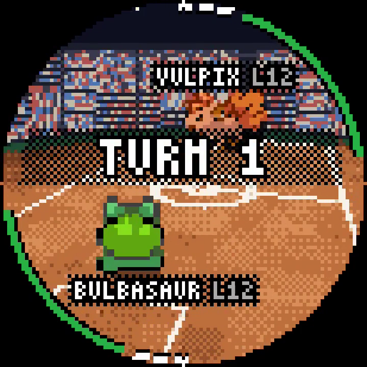<figcaption>Turn one. Health runs round the rim.</figcaption></figure>
  <figure class="pixel" style="margin:0;">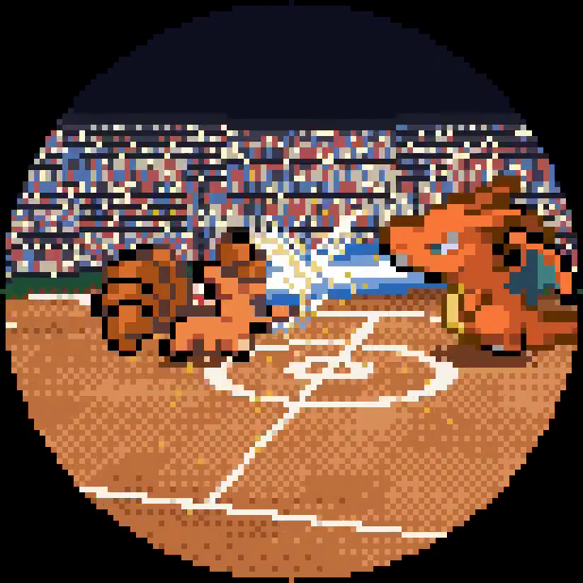<figcaption>A clash: both beams meet in the middle.</figcaption></figure>
  <figure class="pixel" style="margin:0;">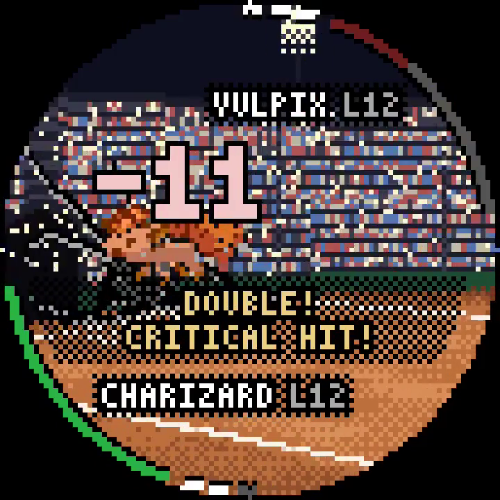<figcaption>The critical side wins the struggle.</figcaption></figure>

<section class="prose" markdown="1">

## When the camera swings side-on

Most turns play one attack after the other from behind your Pokémon's shoulder. A
**critical hit** changes that. When a turn has a critical hit and both Pokémon get to
attack, the camera swings round side-on and they fire at the same moment. The two attacks
meet in the middle of the field as a crackling ball of energy, and it shoves back and forth
while the stadium shakes and the crowd's cameras flash. Then the side that landed the
critical hit drives through.

It stays honest. The engine already decided the turn, so if the other side struck first,
its hit lands first; if the critical hit knocks it out before it can act, its beam is
swallowed and never lands at all.

## Knockouts

A knockout gets weight of its own. The last frames slow down, and the Pokémon is thrown
back across the field into the stadium wall. It shrinks as it flies, because it really is
travelling away from you, and where it hits, the wall cracks. The crack stays there for the
rest of the battle, so a long match leaves its marks on the stadium.

</section>

  <figure class="pixel" style="margin:0;">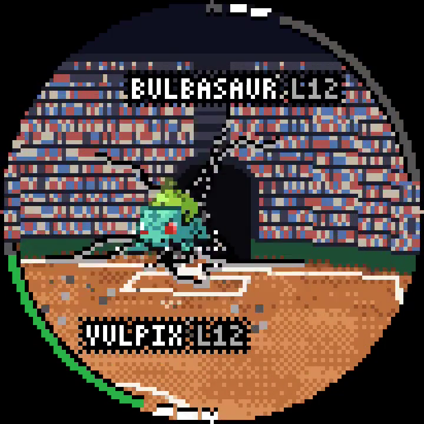<figcaption>Thrown into the far wall.</figcaption></figure>
  <figure class="pixel" style="margin:0;">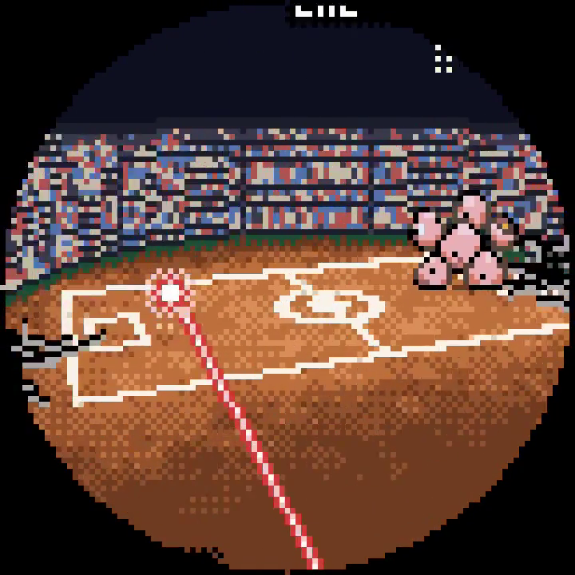<figcaption>The recall beam.</figcaption></figure>
  <figure class="pixel" style="margin:0;">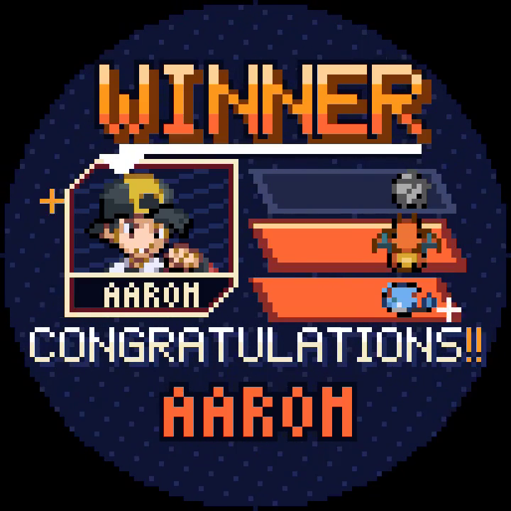<figcaption>The winner's board.</figcaption></figure>

<section class="prose" markdown="1">

## How it's won

A battle ends when one side has no Pokémon left standing. When a Pokémon faints and its
trainer still has others, the scoreboard shows, and the next one is thrown in. When the
last one goes down, there is no scoreboard: the loser fades away at the wall, the winner
stands in the stadium, and the WINNER board closes over them. A battle that somehow runs to
two hundred turns is a draw.

Every result goes on your trainer card as wins, losses and draws, kept separately for
local, online and ranked battles, along with your best winning streak.

## Gym leaders

The gym challenge runs through all sixteen leaders region by region: the eight from Kanto,
Brock to Blue, then the eight from Johto, Falkner to Clair. Each brings Pokémon from their
own roster and their own portrait on the match card. The battles run on Generation 1's
rules, so a Johto Pokémon fights with the stats of a close Kanto stand-in (Steelix as Onix,
Miltank as Tauros) while still looking and sounding like itself, and moves that only exist
in Gold are left out.

A leader's team isn't fixed. They size up the team you've brought and pick their Pokémon
and levels to stay a little stronger than you, whatever your level. There's a [whole post
on how they do it](the-leader-reads-your-team.html).

Beat one and the badge is yours. It grows in on a burst of light ("FALKNER GAVE YOU THE
ZEPHYR BADGE, 1/16"), lands on a badges page of your trainer card, and the menu offers the
next leader.

</section>

  <figure class="pixel" style="margin:0;">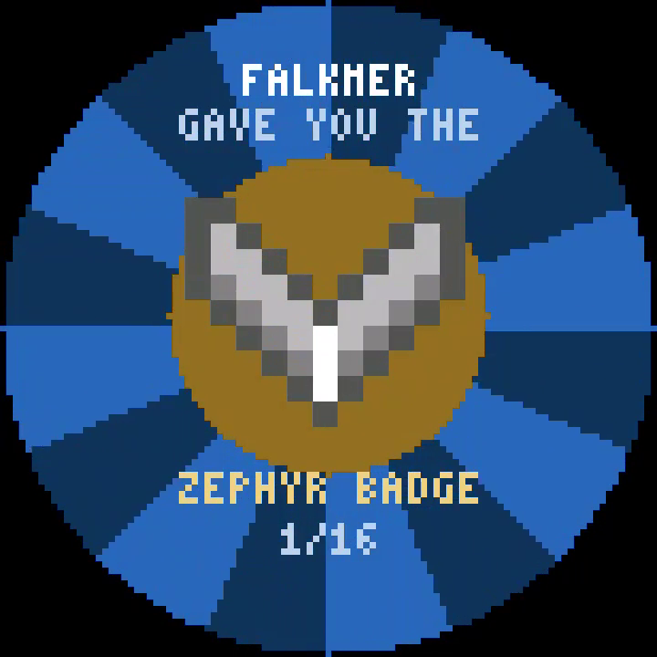<figcaption>The Zephyr Badge.</figcaption></figure>
  <figure class="pixel" style="margin:0;">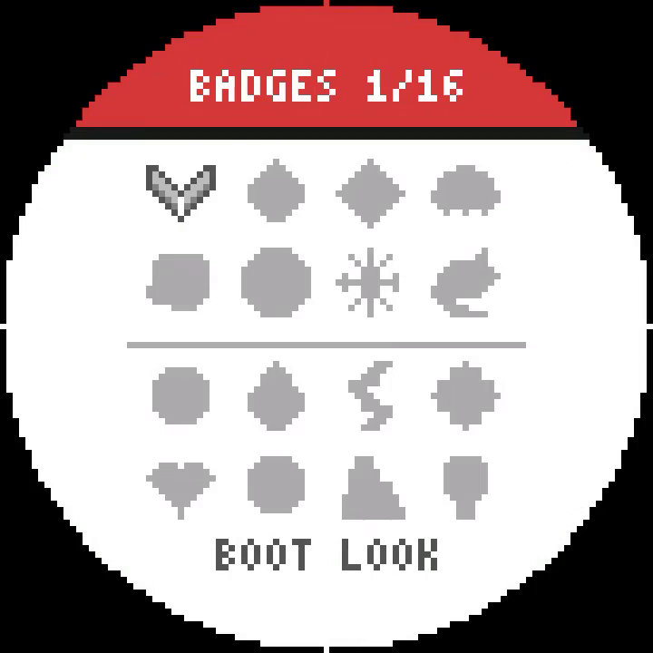<figcaption>Fifteen to go.</figcaption></figure>

<section class="prose" markdown="1">

## Sound

Battles play Pokémon Blue's battle themes on the walker's emulated Game Boy sound chip:
Trainer Battle for a quick battle, Gym Leader for a gym, Final Battle for Blue, and the
victory tune once if you win. Every move plays the sound effect Pokémon Gold gives it,
recorded from the game's own sound engine, and each Pokémon cries when it comes out and
when it falls.

## Still to come

Battles are in the walker's software and run in its desktop simulator and the browser
build; they haven't been played on the board itself yet. Battles against other people's
walkers are next, through the portal: challenge a friend and the server plays both sides'
tactics, or battle live and choose each turn yourself, with every match kept as a replay a
few hundred bytes long.

</section>
