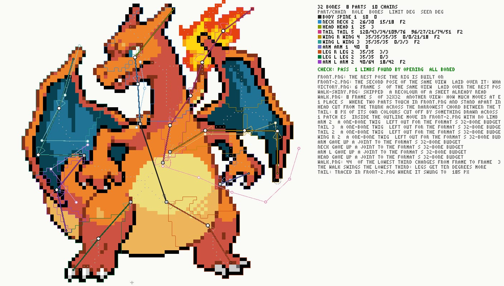
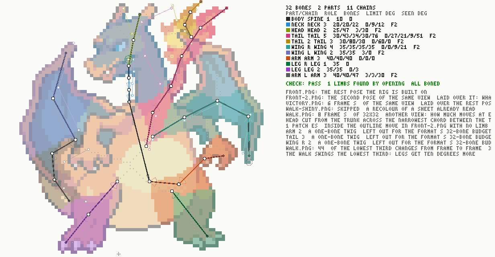
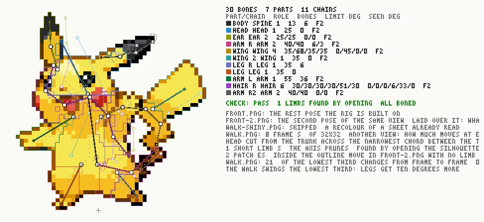
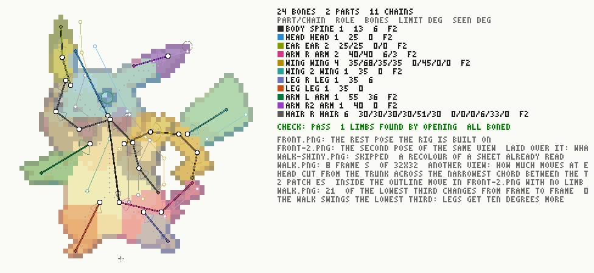
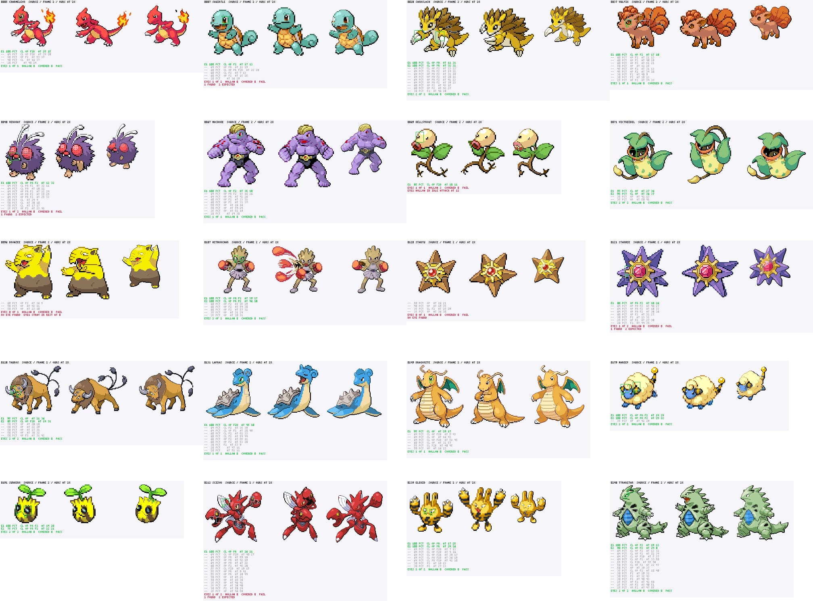

<section class="prose" markdown="1">

A sprite is a grid of coloured squares. It cannot bend its tail, turn its head or curl into
a ball. Everything a sprite does, an artist drew frame by frame.

So the walker now reads a sprite the way an animator would. It traces each part as smooth
outlines, works out where the body, head, tail and limbs are, and puts a skeleton inside.
From then on the creature is data: curves on bones, drawn fresh on every frame.

## The skeleton finds itself

</section>

<figure style="margin-inline:auto;">
  
  <figcaption>Charizard: 32 bones in 10 chains. The neck, the five-bone tail, both wings, arms and legs.</figcaption>
</figure>

<section class="prose" markdown="1">

Nobody placed these bones. The rig comes from the sprite sheet itself. The front view gives
the rest pose. The game's second frame, laid over it, shows what moves and how far. The
32×32 walking sprites show how much moves at each joint as it walks.

Each chain gets a role (spine, neck, head, tail, wing, arm, leg) and a limit for every
joint, so a wing can sweep but an elbow cannot fold backwards. The format has a budget of
32 bones. Charizard hits it, so a few one-bone twigs are left out and say so in the table.

</section>

<figure style="margin-inline:auto;">
  
  <figcaption>Which bone owns which part of the body. This is what bends when a bone turns.</figcaption>
</figure>

<section class="prose" markdown="1">

Pikachu gets the same treatment from the same code: 30 bones, the ears as their own chains,
the zigzag tail as a long one.

</section>

  <figure>
    
    <figcaption>Pikachu's skeleton over the sprite.</figcaption>
  </figure>
  <figure>
    
    <figcaption>And the parts each chain moves.</figcaption>
  </figure>

<section class="prose" markdown="1">

## Eyes are their own check

An eye is a dozen pixels out of a thousand. Lose one and the outline still matches almost
perfectly, but the creature looks dead. So eyes are checked on their own: found, not
hollow, and not covered by another part in any pose of any move. A creature that fails is
not finished.

Finding eyes is the hard part. The finder is right on about three species in five. Here it
is across twenty random ones, with each species' boxes and verdict.

</section>

<figure style="max-width:none;margin-inline:auto;">
  
  <figcaption>Source, second frame, and ours, for twenty species. Green is a pass, red a miss.</figcaption>
</figure>

<section class="prose" markdown="1">

## Moving, and redrawn

Once there is a skeleton, a move is a set of eased curves on bones over time. Moves are
written once and work on any creature: a jump and spin, a bounce, a look round, a slow tail
swish, a sleepy sway, and now a ball spin, where it curls up, spins with sparks and lands.

Because nothing is stored as pixels, the line style is a choice made at draw time. These
two clips are the same data drawn bold and thin, side by side.

</section>

<figure style="margin-inline:auto;">
  <video controls playsinline preload="metadata"
         poster="../assets/img/pokewalker/maths-charizard-bold-thin-poster.png"
         width="2112" height="1028">
    <source src="../assets/video/pokewalker/maths-charizard-bold-thin.mp4" type="video/mp4">
  </video>
  <figcaption>Charizard as shapes, idling. Bold lines and thin lines from the same file.</figcaption>
</figure>

<figure style="margin-inline:auto;">
  <video controls playsinline preload="metadata"
         poster="../assets/img/pokewalker/maths-bulbasaur-bold-thin-poster.png"
         width="960" height="516">
    <source src="../assets/video/pokewalker/maths-bulbasaur-bold-thin.mp4" type="video/mp4">
  </video>
  <figcaption>Bulbasaur, the same way.</figcaption>
</figure>

<section class="prose" markdown="1">

## Small enough for the walker

Charizard as shapes is 14.5 KB, Pikachu 8.1 KB and Bulbasaur 5.2 KB, each covering both of
the game's frames and every move. The renderer that draws them is integer-only and
allocates nothing while drawing, so it runs on the walker's own chip, not just on a desktop.

What it cannot do yet: the back of Charizard, built from tiny 32-pixel walking frames, is
still rough, and the eye finder misses two species in five.

</section>
