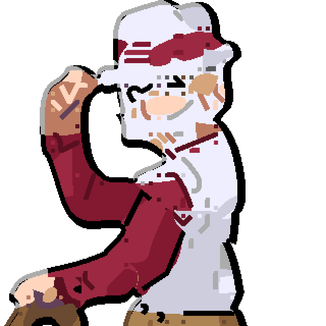
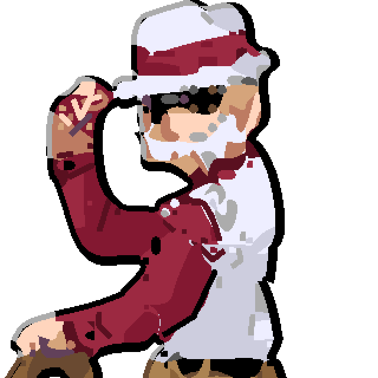
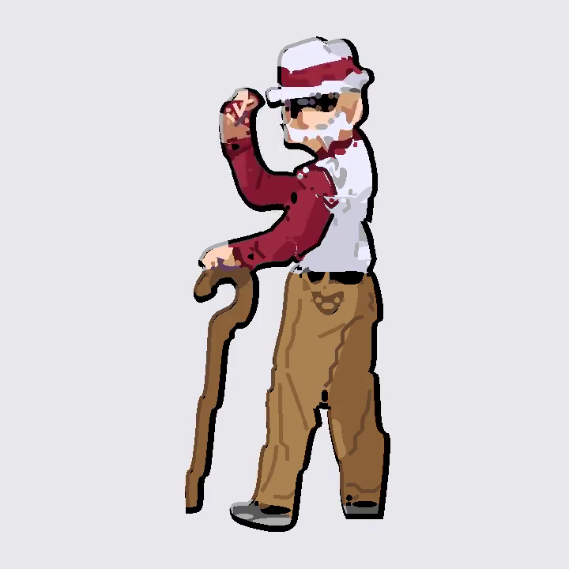
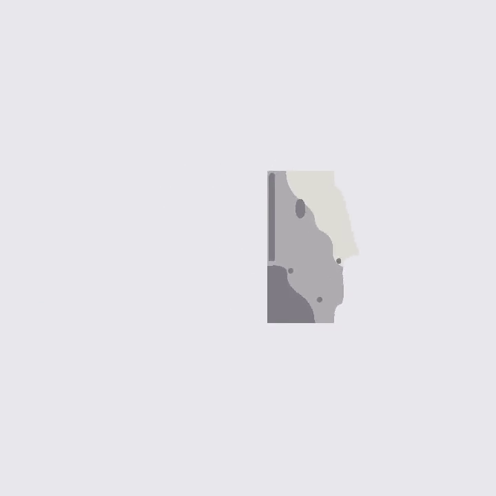
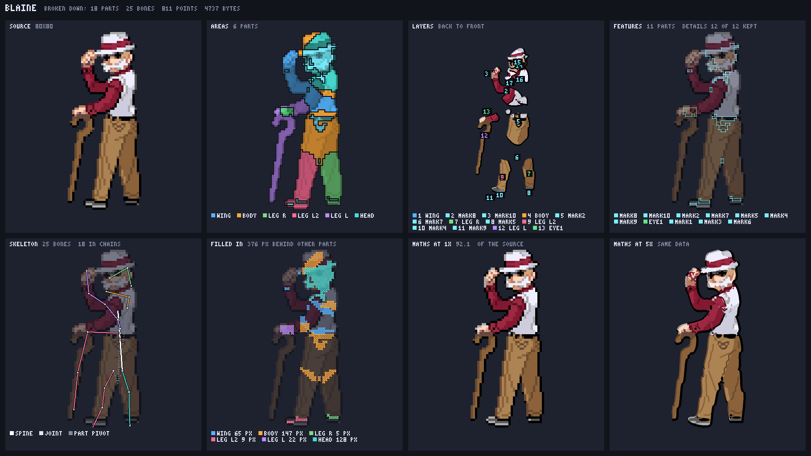
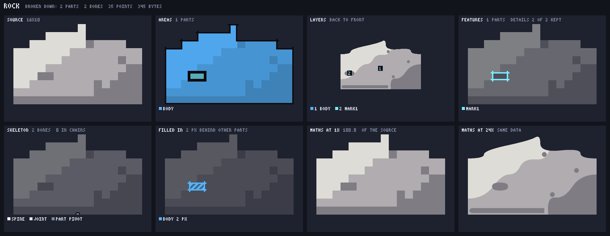
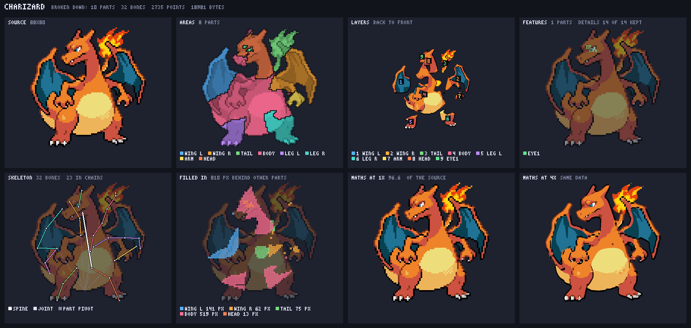
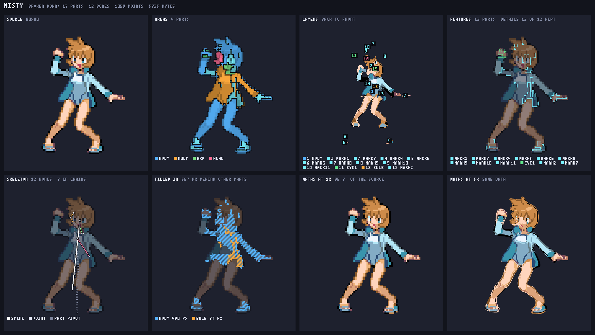

<section class="prose" markdown="1">

[The last post](a-pokemon-made-of-maths.html) turned a Pokémon's sprite into curves on a
skeleton. To do that, the tool guessed what each part was: body, head, tail, wing, eye.
The guess did more than name things. It decided which details were kept carefully. A patch
taken for an eye was kept as a solid shape. Everything else small was traced as thin
interior lines.

On a Pokémon that mostly works. On anything else it doesn't.

## Blaine

Blaine is the Cinnabar gym leader: an old man in a white hat and dark glasses, one hand
raised to the brim. The tool called his raised arm a wing. That cost nothing, since a wing
is only a label. His glasses were not called anything, so they were traced as lines, and
at 8x they came apart.

</section>

<div class="fig-pair" style="max-width:none;">
  <figure>
    
    <figcaption>Before, at 8x. The glasses are scattered dashes. The overall match said 90.9%.</figcaption>
  </figure>
  <figure>
    
    <figcaption>After. The glasses are one solid shape.</figcaption>
  </figure>
</div>

<section class="prose" markdown="1">

The worst part was the score. 90.9% of his pixels matched, which sounds fine, and his face
was ruined. A face is a small corner of the picture, and one number over the whole of it
cannot see what happened there.

## The pixels decide

So the tracing no longer depends on what anything is called. Details are found from the
pixels alone: small patches that stand out from what they sit on. A lens on skin, a button
on a shirt, a crack in a rock. The tool does not need to know which is which.

Each detail is kept as a solid shape. In a single picture it becomes a part of its own,
riding the bone of whatever it sits on. A detail drawn in several dark shades goes down as
one patch first, so a pair of glasses is a pair of glasses and not a row of beads.

Three smaller fixes help every picture. A speck of one pixel stays a rounded square at large
sizes instead of shrinking to a dot. A line drawn in two shades no longer leaves a gap where
the shades meet. And a picture with no dark outline, like a rock shaded to its edge, is
traced to its edge and drawn without one.

## A check one number cannot hide

Every detail found in the source is now looked for in the result, at 1x and at 8x, colour by
colour. If a detail doesn't come back in its own colours, or comes back in pieces, the
creature is refused with the box of what was lost.

The old Blaine fails it on his face: the black of his glasses was 40% there at 8x. The new
one passes with all twelve of his details.

## Labels only choose motions

The tool still guesses roles, because a role is useful: a tail gets a swish, an eye gets a
blink. But a label now only picks default motions and the order parts stack in when they
move. It can never change the drawing.

When a guess is wrong, a tweak fixes it. A tweak is one line of text, kept beside the
creature and applied again every time it is made:

```
label wing arm
feature 46,9,53,13 glasses
follow glasses head
```

The same goes for motion. Something with no second frame can still be posed, by writing a
track for one bone by hand. Blaine has no drawn wave and a rock has no drawn roll.

</section>

<div class="clip-grid">
  <figure class="clip-auto">
    <video muted loop autoplay playsinline preload="metadata"
           poster="../assets/img/pokewalker/maths-engine-blaine-wave-poster.png" width="720" height="720">
      <source src="../assets/video/pokewalker/maths-engine-blaine-wave.mp4" type="video/mp4">
    </video>
    
    <figcaption>Blaine waving: one hand-written track on the arm the tool first called a wing.</figcaption>
  </figure>
  <figure class="clip-auto">
    <video muted loop autoplay playsinline preload="metadata"
           poster="../assets/img/pokewalker/maths-engine-rock-roll-poster.png" width="720" height="720">
      <source src="../assets/video/pokewalker/maths-engine-rock-roll.mp4" type="video/mp4">
    </video>
    
    <figcaption>A rock rolling. It has one rigid part and no limbs, and that is right.</figcaption>
  </figure>
</div>

<section class="prose" markdown="1">

## The breakdown sheet

Every creature now comes with one picture of how it was taken apart. Here is Blaine's.

</section>

<figure class="pixel" style="max-width:none;margin-inline:auto;">
  
  <figcaption>Blaine, broken down: 18 parts, 25 bones, 811 points, 4,737 bytes.</figcaption>
</figure>

<section class="prose" markdown="1">

Read it left to right, top row first.

1. **Source.** The 80×80 picture it started from.
2. **Areas.** Each part in its own colour. Blaine has six: head, body, two legs, a second
   leg piece and the arm still labelled wing.
3. **Layers.** The parts pulled apart and numbered back to front, so you can see what sits on
   what when they move.
4. **Features.** Every detail the pixels gave up, outlined. A lost one would be red. Here all
   twelve are kept.
5. **Skeleton.** 25 bones, the spine in white.
6. **Filled in.** Hatched areas are pixels nobody drew: what is hidden behind another part,
   filled in so that part can move without leaving a hole.
7. **Maths at 1x.** The result at the sprite's own size: 92.1% of the source.
8. **Maths large.** The same data drawn at 5x.

The sheet is drawn from the creature's own data, so it shows every tweak and edit too.

## A rock, a berry, and the Pokémon again

The point was any picture. A 16×10 rock comes out at 100%, in 345 bytes.

</section>

<figure class="pixel" style="max-width:none;margin-inline:auto;">
  
  <figcaption>The rock: one part, two details, 100% at 1x. Large, it is smooth stone.</figcaption>
</figure>

<section class="prose" markdown="1">

A 9×9 berry has no outline at all. Traced to its edge, it went from 78.6% to 97.6%.
Lt. Surge, another gym leader, comes out at 94.1%.

The Pokémon did not get worse for it. The match went up on every pose but one, which fell
by a tenth of a point:

| Species | Before | Now |
| --- | --- | --- |
| Bulbasaur | 95.5 / 93.0% | 95.4 / 95.6% |
| Charizard | 96.1 / 93.6% | 96.6 / 94.7% |
| Pikachu | 88.9 / 89.4% | 90.1 / 91.3% |
| Misdreavus | 88.4 / 82.7% | 90.9 / 85.3% |

The two numbers are the game's two frames. The price is size: the files are 17 to 45%
bigger, because details are now filled shapes and specks keep their corners. Charizard is
19 KB.

</section>

<figure class="pixel" style="max-width:none;margin-inline:auto;">
  
  <figcaption>Charizard through the same sheet: 32 bones, 14 of 14 details kept.</figcaption>
</figure>

<section class="prose" markdown="1">

## At game size

All of that is judged up close. On the walker, nobody sees Blaine at 8x. Here is his real
gym entrance on the walker's round glass, the original sprite on the left and the maths
Blaine on the right.

</section>

<figure style="margin-inline:auto;">
  <video controls playsinline preload="metadata"
         poster="../assets/img/pokewalker/maths-engine-blaine-intro-poster.png"
         width="824" height="412">
    <source src="../assets/video/pokewalker/maths-engine-blaine-intro.mp4" type="video/mp4">
  </video>
  <figcaption>Blaine's gym intro, twice. Left, the original sprite. Right, Blaine as maths.</figcaption>
</figure>

<section class="prose" markdown="1">

They are nearly impossible to tell apart.

## What is still wrong

Labels still guess wrong. Blaine's arm is a wing until a tweak says otherwise, and Misty's
torso is called a bulb, a word that only makes sense on Bulbasaur. It only changes how they
move, never how they look.

A detail is found by rule, and the rule takes the folds of a shirt or a camouflage pattern
for details. They get kept as parts that are nothing in particular.

Misty's skeleton is poor: twelve bones, with one long spine running down between her legs
instead of a bone for each.

</section>

<figure class="pixel" style="max-width:none;margin-inline:auto;">
  
  <figcaption>Misty traces at 98.7% and keeps all twelve details. Her skeleton is the weak part.</figcaption>
</figure>

<section class="prose" markdown="1">

And nothing has been timed on the walker with the bigger files. Before they grew, an
estimate from the desktop put a frame at 12 to 44 ms on the walker's chip. Bigger files
will not make that smaller.

</section>
