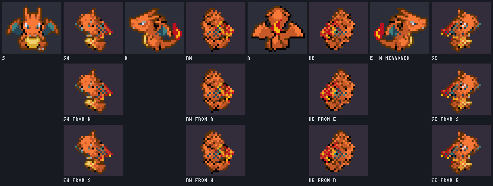
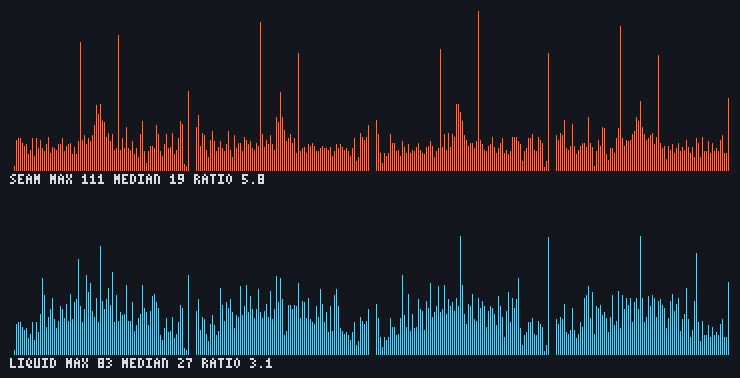

<figure style="margin-inline:auto;">
  <video controls playsinline preload="metadata"
         poster="../assets/img/pokewalker/liquid-nidoking-thermal-poster.jpeg"
         width="1280" height="360">
    <source src="../assets/video/pokewalker/liquid-nidoking-thermal.mp4" type="video/mp4">
  </video>
  <figcaption>Nidoking bracing while the camera circles him, in heat colours. Left: the old seam. Right: the liquid turn.</figcaption>
</figure>

<section class="prose" markdown="1">

The creatures on the walker [are made of maths](./a-pokemon-made-of-maths.html), and lately
they [move like it too](./moves-are-numbers-too.html). But each one only has a few real
views: a front, a side and a back. The other side is the first one mirrored. That is all an
artist ever drew for a follower, and it is all we have.

So when the camera swung round a creature, it cut from one view to the next. Nidoking would
be side on, and then, one degree later, he would be facing you. A little blip, every quarter
turn. It's fine on a sprite that never moves the camera. It looks awful in a park you can
walk round.

## First try: move the parts

The creature is already built from parts: a head, a body, arms, a tail. So the obvious idea
was to turn each part on its own, slide it round the body, and let them overlap properly.

</section>

<figure style="margin-inline:auto;">
  <video controls playsinline preload="metadata"
         poster="../assets/img/pokewalker/liquid-charizard-parts-poster.jpeg"
         width="1280" height="720">
    <source src="../assets/video/pokewalker/liquid-charizard-parts.mp4" type="video/mp4">
  </video>
  <figcaption>Left: parts turned one by one. Right: the relief, the second try.</figcaption>
</figure>

<section class="prose" markdown="1">

It pulled his face off. The parts were cut out of a flat drawing, so they have no idea how
deep they are. Turn them and the snout drifts away from the head, and the head drifts away
from the neck. Watch the left-hand Charizard for a bit and it gets quite upsetting.

## Second try: a relief

So stop thinking in parts and think in bodies. Take each view and lift it into a shallow
relief, row by row: as wide as this view's ink, and as deep as the neighbouring view's ink.
The side view tells you how deep the front is, and the front tells you how deep the side is.
Turn that with a depth buffer and you get one solid body, not a pile of stickers.

That was much better, on the right above. But each relief is still only good near its own
view. At some point you have to hand over from the front's relief to the side's, and at the
handover the outline snaps. A smaller blip, but still a blip.

## Third try: pour it

Now the turn is liquid. At any bearing, both neighbouring views are turned to face the
camera. Each one becomes a distance field: for every pixel, how far it is from that view's
outline, inside or out. The outline drawn on screen is where a blend of the two fields
crosses zero, and the blend eases across the whole quarter turn. The shape pours from one
silhouette into the next, like filling a Pikachu-shaped bottle.

</section>

<figure style="margin-inline:auto;">
  <video controls playsinline preload="metadata"
         poster="../assets/img/pokewalker/liquid-nidoking-compare-poster.jpeg"
         width="1280" height="720">
    <source src="../assets/video/pokewalker/liquid-nidoking-compare.mp4" type="video/mp4">
  </video>
  <figcaption>Nidoking orbited. Left: the seam. Right: liquid.</figcaption>
</figure>

<section class="prose" markdown="1">

Colour is the fiddly part, because a blend of two colours is a colour neither drawing has,
and the whole point of these creatures is crisp pixel art. So each pixel looks up the
matching spot in both views, by how far down the row it sits, and takes one of the two real
palette colours. Which one it takes switches over on a Bayer pattern, so the change sweeps
across the body as a staggered dither rather than a smear. Every pixel on screen is still a
colour the artist chose.

</section>

<figure style="margin-inline:auto;">
  <video controls playsinline preload="metadata"
         poster="../assets/img/pokewalker/liquid-charizard-compare-poster.jpeg"
         width="720" height="720">
    <source src="../assets/video/pokewalker/liquid-charizard-compare.mp4" type="video/mp4">
  </video>
  <figcaption>Charizard, the same comparison.</figcaption>
</figure>

<section class="prose" markdown="1">

Nothing in between is stored. There is no diagonal drawing of Charizard anywhere. The 45°
view, the 37° view, the 3° view are all worked out live, every frame, from those three
drawings.

</section>

<figure style="max-width:none;margin-inline:auto;">
  
  <figcaption>Eight directions. Only S, W and N were drawn. Each diagonal is shown from both neighbours, and they agree.</figcaption>
</figure>

<section class="prose" markdown="1">

## Did it work?

To put a number on "snaps", I turn the camera one degree at a time and measure how much of
the picture changes each step. A smooth turn changes a bit every step. A snap is one step
that changes far more than the rest. So the score is the biggest step over the typical one.

</section>

<figure style="max-width:none;margin-inline:auto;">
  
  <figcaption>Change per degree for Nidoking, all the way round. Seam on top, liquid below.</figcaption>
</figure>

<section class="prose" markdown="1">

| Biggest step ÷ typical step | Seam | Liquid |
|---|---|---|
| Charizard | 5.4 | 3.1 |
| Nidoking | 5.8 | 3.1 |
| Charizard in battle | 4.6 | 2.9 |

The spikes are gone. The honest cost is in the graph too: the blue baseline is a bit busier,
because the dither is always shimmering a little somewhere while the body pours. I'll take a
gentle shimmer over a blip every quarter turn.

It's all integer maths with no allocation, the same rules as the rest of the creature code,
so it can run anywhere the walker does. Next it goes into battles, the park, flight and the
shorts, wherever a camera gets to move round a creature.

</section>
