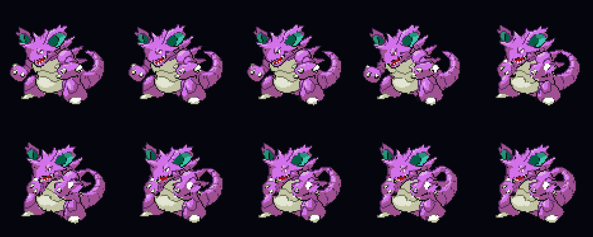
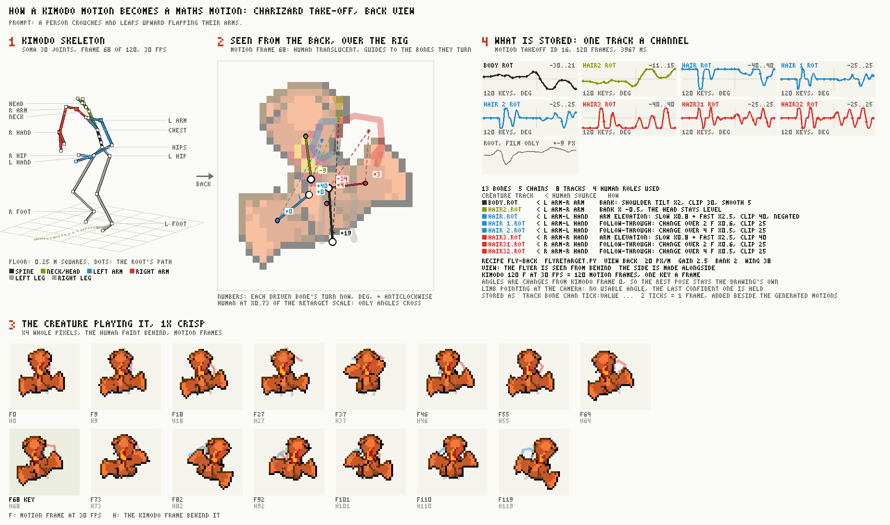
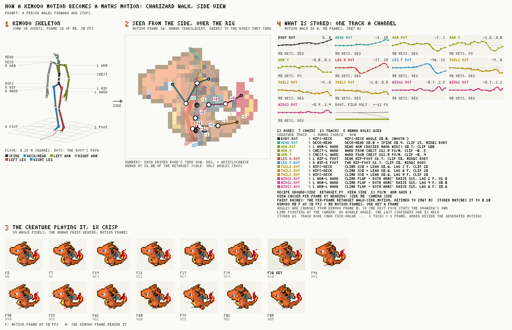
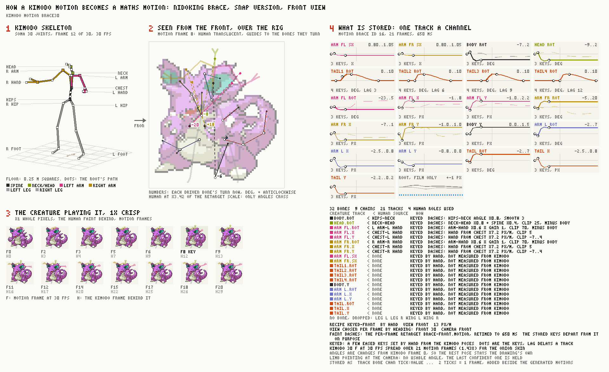

<figure style="margin-inline:auto;">
  <video controls playsinline preload="metadata"
         poster="../assets/img/pokewalker/maths-motion-takeoff-poster.jpeg"
         width="960" height="540">
    <source src="../assets/video/pokewalker/maths-motion-takeoff.mp4" type="video/mp4">
  </video>
  <figcaption>Charizard taking off in the park, recorded straight out of the walker's own renderer: the crouch, the leap, the climbing wingbeat, then a glide that leans into each turn.</figcaption>
</figure>

<section class="prose" markdown="1">

That is the real park flight, the same code the browser walker and the portal run. The only
thing new in it is what Charizard knows how to do.

## A move is a curve, not a flipbook

The creatures on the walker [are made of maths](./a-pokemon-made-of-maths.html): outlines,
a skeleton, and moves. A sprite animation stores every frame as pixels. A move here stores
none. It is a set of curves, one per bone, saying how far that bone is turned at each moment,
plus the odd nudge or squash. Those curves live inside the creature's own file, next to its
shapes.

Every frame the walker asks "where is every bone at 1,240 ms?", poses the skeleton and draws
the outlines fresh at 1x, on the creature's own pixel grid. That has a few nice side effects.
A move plays at any speed and any frame rate, because time is continuous and there are no
frames to drop. Two moves can be faded into each other, because halfway between two angles
is just another angle. And a move costs a few kilobytes at most, not a sprite sheet.

## Three ways to make one

**By rule.** Every creature gets a set of moves the moment it is made: idle, hop, attack, a
look round, a tail swish. They are built from the skeleton alone, so they work on anything
with a tail or a head. Nidoking's tail used to sit still while he idled. One command folded a
swish into his idle, twice as big and lagging down the tail so the tip follows the base:

</section>

<figure style="margin-inline:auto;">
  <video controls playsinline loop muted autoplay preload="metadata"
         poster="../assets/img/pokewalker/maths-motion-nidoking-idle-poster.jpeg"
         width="736" height="336">
    <source src="../assets/video/pokewalker/maths-motion-nidoking-idle.mp4" type="video/mp4">
  </video>
  <figcaption>Nidoking's idle before and after <code>make swish --into idle --gain 2 --lag 14</code>. Left: before. Right: the tail sways.</figcaption>
</figure>

<section class="prose" markdown="1">

**By hand.** Rules are good at loops. They are bad at a single moment with weight in it. For
those I set a handful of keys on the bones and let the easing do the rest. Nidoking's brace
is 150 ms of snap: a little anticipation first, then the body snaps back past where it ends
up and settles, the arms pull in, the back arches, the knees flex and the feet stay planted.
Every one of those is a few keys on one bone.

</section>

<figure style="margin-inline:auto;">
  <video controls playsinline loop muted autoplay preload="metadata"
         poster="../assets/img/pokewalker/maths-motion-nidoking-brace-poster.jpeg"
         width="720" height="330">
    <source src="../assets/video/pokewalker/maths-motion-nidoking-brace.mp4" type="video/mp4">
  </video>
  <figcaption>Nidoking bracing, keyed by hand.</figcaption>
</figure>

<figure style="max-width:none;margin-inline:auto;">
  
  <figcaption>The brace frame by frame.</figcaption>
</figure>

<section class="prose" markdown="1">

**From a motion model.** [Today's earlier post](./new-moves-from-a-sentence.html) was about
Kimodo, which writes a human movement from a sentence. Its sibling MotionBricks does two
things Kimodo can't: steer a walk towards a target, and fill in the motion between two poses
I choose. Neither of them ever draws anything. What comes out is a skeleton's joints moving
over time, which gets filmed from the side, front or back, turned into angles on screen, and
mapped onto our bones.

The sheets below show the whole trip in one picture: the human skeleton, the same moment laid
over the creature's rig, the creature playing it, and what actually gets stored, one curve
per channel.

</section>

<figure style="max-width:none;margin-inline:auto;">
  
  <figcaption>"A person crouches and leaps upward flapping their arms", from behind. Each arm drives one wing, and the outer wing bones trail a frame or two behind so the wing bends through the stroke.</figcaption>
</figure>

<figure style="max-width:none;margin-inline:auto;">
  
  <figcaption>A walk from the side. Thirteen tracks, each one traced back to the part of the human it came from.</figcaption>
</figure>

<figure style="max-width:none;margin-inline:auto;">
  
  <figcaption>The brace again, with its Kimodo reference shown faintly behind. The stored keys depart from it on purpose: the human gives the timing, the hand-set keys give the snap.</figcaption>
</figure>

<section class="prose" markdown="1">

That last one is how the methods actually get used together. The model is good at timing
and weight. A few keys by hand are good at exaggeration, which a real person bracing doesn't
do and a cartoon dragon should.

## Keeping them

Creatures get remade. The tracer improves, an eye gets fixed, the skeleton finder learns
something, and the whole creature is built again from its sprites. A move that only lived in
the old file would be gone.

So moves that matter are kept as a log: a short text file of the motion commands that made
them. Every remake replays the log on top of the fresh creature, so the moves come back on
the new skeleton. For a creature that is already committed, a replay can add the logged moves
to one view, Charizard's back, and leave every other byte of the file exactly as it was. That
is how the flight moves went in without touching anything else Charizard does.

The flight moves also have fixed numbers: takeoff is 11, flap 12, glide 13, bank 14 and a
barrel roll 15. Bank is a scrub rather than a loop: fully left at its start, level in the
middle, fully right at its end, and flight plays it at whatever angle the turn wants.

## It reaches the game

Flight looks for those numbers. A flyer that has them takes off with its takeoff, beats its
wings while it climbs or hurries, glides when it is level, fades between the two, and leans
into turns with its own bank instead of the whole picture tipping. A flyer that has none
flies the way it always did. Charizard is the first to have them. Any creature given the same
five moves gets the same treatment, with no change to the flight code.

## What doesn't work yet

The walker's followers are 32 pixels tall, so arms are three or four pixels. A punch or a
wave moves almost nothing. Whole-body moves read; small-limb moves mostly don't.

Some limbs are still split out by hand. The generated skeleton sometimes keeps a leg as part
of the body, and then there is nothing for a stride to turn. Splitting limbs automatically is
being built now.

The turn between views isn't smooth yet. A creature going from side-on to facing away still
cuts from one drawing to the next, and a proper turn is in progress.

</section>
