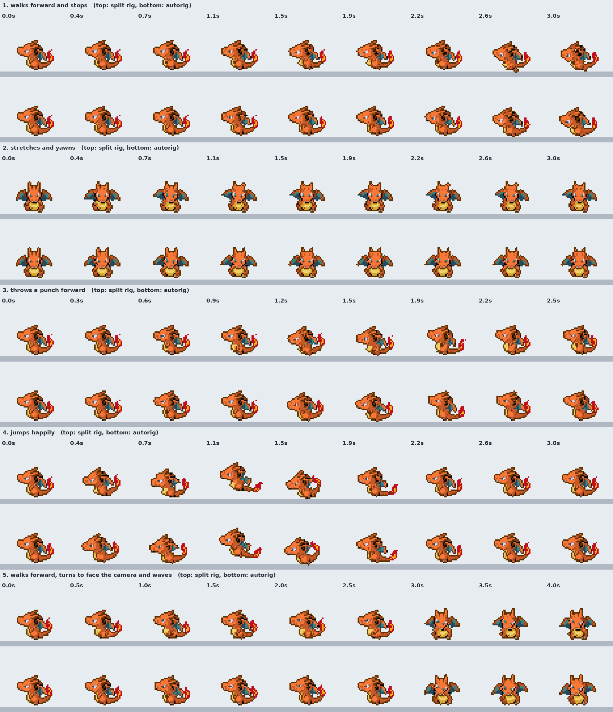
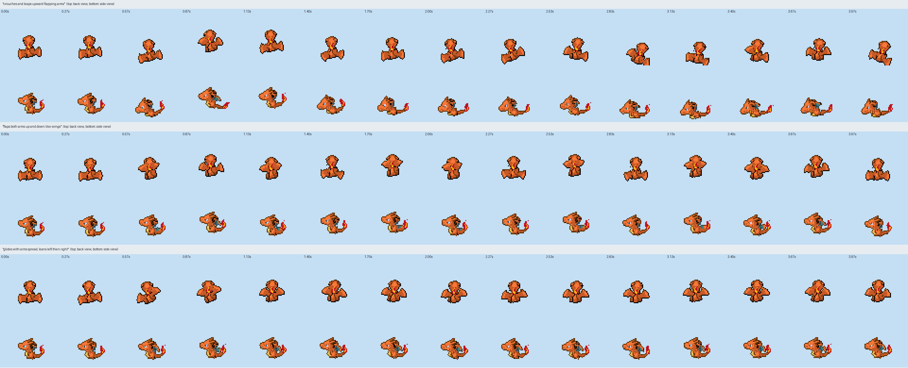

<section class="prose" markdown="1">

Yesterday's creatures came with a handful of moves written by rule: a jump and spin, a
bounce, a look round, a tail swish. Rules are good at small, tidy motions. They are bad at
anything with weight and timing, like a body crouching, leaping and catching itself.

That is exactly what text-to-motion models are good at. [Kimodo](https://github.com/localai-org/kimodo.cpp)
is one of them: NVIDIA's Kimodo model, ported to plain C++ by the LocalAI folks. You give it
a sentence and a length, and it gives back a skeleton moving at 30 frames a second. It runs
on an ordinary CPU, which is all I wanted to spend on it.

The catch is that it writes motion for a person. Thirty joints, two arms, two legs, a head
on a neck. Charizard has wings, a tail, stubby arms and a follower sprite 32 pixels tall.

## A person, seen from one side

The trick is to stop thinking in 3D. A follower is never seen in 3D: it is a front, a side
or a back, drawn flat. So the human is filmed from one of those directions, and each limb
becomes an angle on the screen.

From the side, the hips-to-neck line becomes Charizard's lean, the legs become its legs,
and the way the body rises and falls feeds a lagging sway down the tail. From the front,
the arms become arms and the shoulders lift the wings. Which view to use is picked from the
motion itself: lots of forward-and-back limb movement means side on, lots of side-to-side
means front on. When a limb points straight at the camera it has no usable angle, so it
holds its last good one rather than flicking about.

Five sentences, onto the follower as the walker already rigs it:

</section>

<figure style="margin-inline:auto;">
  <video controls playsinline preload="metadata"
         poster="../assets/img/pokewalker/kimodo-five-prompts-poster.jpeg"
         width="720" height="244">
    <source src="../assets/video/pokewalker/kimodo-five-prompts.mp4" type="video/mp4">
  </video>
  <figcaption>Walk and stop, stretch, punch, jump, and walk, turn and wave. Left: limbs split by hand. Right: the rig as the walker makes it.</figcaption>
</figure>

<figure style="max-width:none;margin-inline:auto;">
  
  <figcaption>The same five, frame by frame.</figcaption>
</figure>

<section class="prose" markdown="1">

The jump is lovely. He crouches, throws himself up and back, and the tail whips after him.
Walking forward and stopping reads well too, because the stop is in the whole body.

The punch, the stretch and the wave do almost nothing. They are arm moves, and a
follower's arm is three or four pixels. There is nothing there to throw a punch with.

## It lost to our walk

The obvious next question was whether Kimodo should simply take over the walk. It is a real
walk cycle from real motion data. Ours is two drawings swapped every 170 ms.

</section>

<figure style="margin-inline:auto;">
  <video controls playsinline preload="metadata"
         poster="../assets/img/pokewalker/kimodo-walk-compare-poster.jpeg"
         width="720" height="180">
    <source src="../assets/video/pokewalker/kimodo-walk-compare.mp4" type="video/mp4">
  </video>
  <figcaption>Left: the walk the park uses today. Middle: Kimodo on the follower. Right: Kimodo with the legs split into their own bones.</figcaption>
</figure>

<section class="prose" markdown="1">

Ours wins. A human walks at a human pace, and on a creature this small that pace looks
sluggish, like wading. The legs don't help either: at 32 pixels the feet are not separate
enough to plant one and swing the other, even with the legs cut out by hand. The two
drawings were made by an artist who knew all that and cheated accordingly.

What Kimodo did add was the lean into each step and the sway of the tail. Nice, but not
worth giving up a walk that already works.

## It won at flying

Flight is a different story. The flyer is seen from behind, and today it flies by swapping
two poses every 150 ms. From behind, a person flapping their arms maps straight onto a pair
of wings: how high each arm is drives that wing, and each segment further out trails a frame
or two behind, so the wing bends through the stroke instead of hinging.

</section>

<figure style="margin-inline:auto;">
  <video controls playsinline preload="metadata"
         poster="../assets/img/pokewalker/kimodo-fly-vs-now-poster.jpeg"
         width="720" height="266">
    <source src="../assets/video/pokewalker/kimodo-fly-vs-now.mp4" type="video/mp4">
  </video>
  <figcaption>Left: flight today. Middle: "flaps both arms up and down like wings". Right: "glides with arms spread out wide and leans left then right".</figcaption>
</figure>

<section class="prose" markdown="1">

The glide is my favourite. Tilting the shoulders becomes a bank, so he leans into a turn,
holds it, and leans out the other way. Nothing in the rule-written moves does that.

</section>

<figure style="margin-inline:auto;">
  <video controls playsinline preload="metadata"
         poster="../assets/img/pokewalker/kimodo-flap-poster.jpeg"
         width="720" height="402">
    <source src="../assets/video/pokewalker/kimodo-flap.mp4" type="video/mp4">
  </video>
  <figcaption>The flap from behind, as flight draws it, and from the side.</figcaption>
</figure>

<figure style="max-width:none;margin-inline:auto;">
  
  <figcaption>Take-off, flap and glide over four seconds, from behind (top of each row) and the side.</figcaption>
</figure>

<section class="prose" markdown="1">

Take-off nearly works. The crouch and the leap read well. Then the person it came from
lands, because people do, and Charizard pitches forward into a nose-dive. A take-off for a
dragon wants a sentence where nobody comes back down.

## A tool for new moves, not a replacement

So that settles where it fits. Kimodo doesn't replace any move the walker makes for a
creature. It adds new ones next to them: a flap, a glide, a jump, a celebration. You write
the sentence, look at the result on the actual creature, keep it if it reads, and throw it
away if it doesn't. Throwing one away costs about a minute.

That minute is the real cost. A four-second clip takes around 75 seconds on all the cores
of a desktop CPU and holds about 2.5 GB of memory while it thinks. The text model is the
heavy half, so it loads two layers at a time instead of all of them, and a watchdog kills
the run if the machine starts running short. Nothing about it goes near the walker itself:
what comes out is just keyframes on bones, the same as every other move.

The scripts live with the rest of the creature tools, and I've kept a fork of kimodo.cpp so
the build we used stays buildable. Next is the obvious one: a proper take-off, and some
sentences written for a dragon rather than a person.

</section>
